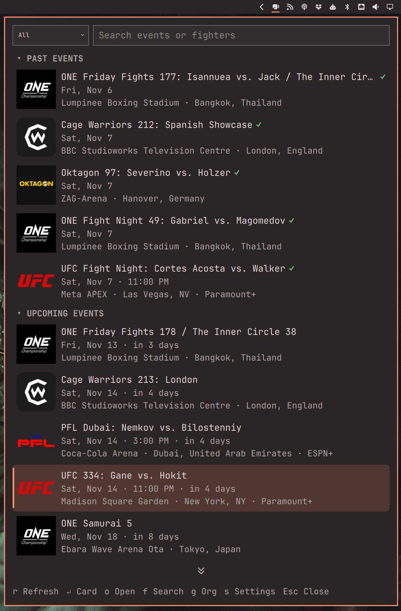

# Omarchy MMA Events

Upcoming MMA events in the Omarchy bar. Click the glove to see what's coming up
from the promotions you follow, then click an event for its full fight card:
main card first, prelims after, with the challenger always on the right.
Once a fight is over, the winner gets a green check, the loser is dimmed, and the round, time and method are shown. This is hidden by default to avoid spoilers; turn on `showResults` to see it.



## Requirements

- Omarchy with the Quickshell-based shell (`omarchy-shell`)
- `curl` and `bash`
- A Nerd Font in the bar (the glyph is `nf-md-boxing_glove`, U+F0B65)
- For the tests only: `node`

## Recommended install

```sh
omarchy plugin add https://github.com/anavarre/omarchy-mma.git --enable
```

## Manual install for local development

```sh
git clone https://github.com/anavarre/omarchy-mma ~/.config/omarchy/plugins/anavarre.mma
omarchy plugin validate ~/.config/omarchy/plugins/anavarre.mma
omarchy plugin enable anavarre.mma
omarchy-shell shell rescanPlugins
```

## Settings

Open the widget's settings in the Omarchy shell (or edit its entry in
`~/.config/omarchy/shell.json`):

| Setting | Default | |
|---|---|---|
| `organizations` | `["ufc"]` | Promotions to follow: `ufc`, `pfl`, `cw` (Cage Warriors), `ksw`, `ares`, `oktagon`, `hxmma` (Hexagone MMA) or `aca` (Absolute Championship Akhmat). UFC and PFL are fully supported; all others are experimental. |
| `eventLimit` | `10` | Events listed at first, 1 to 30. More load as you scroll or arrow down. |
| `lookaheadDays` | `120` | How far ahead to look. |
| `refreshMinutes` | `180` | Background refresh interval. |
| `timeFormat` | `12h` | `12h` or `24h`. |
| `timeZone` | `venue` | Time zone for event times: `venue` (each event's own location, worked out from its venue address) or `local` (this computer's). Also set from the panel's settings, above the text size. |
| `showResults` | `false` | Show winners, losers and how finished fights ended. Off by default, since it spoils results. Also set from the panel's settings. |
| `textSize` | `medium` | `small`, `medium`, `large` or `xlarge`. |

## Using it

- Click the glove: the event list, each event with its promotion's logo. Middle-click: refresh.
- `s` opens the settings view: tick the organizations to follow (UFC on, the others off by default).
  `↑`/`↓` move through every setting (organizations, time zone, keep days, text size);
  Space or Enter toggles an organization, `←`/`→` change the other settings, `Esc` goes back. The choice is saved to `shell.json`.
- `↑`/`↓` move, `Enter` (or click) opens the card, `o` opens the event in your browser,
  `r` refreshes, `Esc` goes back, then closes.
- On a card, `↑`/`↓` scroll and `←` goes back.

Logos are ESPN's league logos for UFC and PFL, the Wikipedia logos for Cage Warriors
(emblem only, on a dark tile) and KSW, ARES's own logo, the Wikimedia Commons logo for Oktagon, the Hexagone MMA emblem from Wikimedia Commons, and the ACA logo from Wikipedia, bundled in `assets/`; they remain the
property of their owners.

## Where the data comes from

ESPN's public JSON API. It needs no key, but it is unofficial and could change.

- `site.api.espn.com/.../mma/<league>/scoreboard` lists upcoming events, their
  fights and fighters.
- `sports.core.api.espn.com/.../competitions/<id>` says which segment each
  fight is on (`main`, `prelims1`, `prelims2`) and its billing. It is fetched
  when an event is opened. If it fails, the card is split by fight start times.
- Fighter `order` 1 is the champion or higher-billed fighter and 2 is the
  challenger. ESPN lists them in no fixed order, so the plugin sorts by it.

### Cage Warriors, KSW, Oktagon and ACA: Wikipedia

ESPN has next to no Cage Warriors coverage, and cagewarriors.com refuses
programmatic clients (it sits behind a bot challenge, which this plugin does not
try to get around). ESPN does list KSW (Konfrontacja Sztuk Walki), but its feed
stops in December 2024. Oktagon (Oktagon MMA, Czech Republic and Slovakia) is not on ESPN at all. ACA (Absolute Championship Akhmat, Russia) is not on ESPN either. So all four come from Wikipedia's
"[2026 in Cage Warriors](https://en.wikipedia.org/wiki/2026_in_Cage_Warriors)" and
"[2026 in Konfrontacja Sztuk Walki](https://en.wikipedia.org/wiki/2026_in_Konfrontacja_Sztuk_Walki)" and
"[2026 in Oktagon MMA](https://en.wikipedia.org/wiki/2026_in_Oktagon_MMA)" and
"[2026 in Absolute Championship Akhmat](https://en.wikipedia.org/wiki/2026_in_Absolute_Championship_Akhmat)"
pages, read through the MediaWiki API (`bin/mma-api wiki cw|ksw|oktagon|aca`). They are maintained by
volunteers and are usually updated within hours of an announcement or a result.
No key or account is needed.

- Upcoming events show the card as announced so far, and finished ones the
  full results. Unlike ESPN, the whole card arrives with the event list, so
  opening one makes no second request for the card itself.
- Wikipedia has no fight records, so opening a card also looks each fighter up
  on [Sherdog](https://www.sherdog.com) (one search and one page per fighter,
  run in parallel, kept until the app restarts). The record appears under the
  name a moment after the card opens. A fighter is shown a record only when
  Sherdog has exactly one fighter by that name, so namesakes and fighters it
  does not list show none rather than a wrong one.
- Wikipedia has dates but no start times, so these events show the day only.
- Cards are as complete as the page: a late change may take a while to appear.
- The event link opens its section on Wikipedia. Wikipedia text is CC BY-SA.

### ARES: the promotion's own site

ARES Fighting Championship (France) is on neither ESPN nor Wikipedia, so its
events are read from [aresfighting.com](https://www.aresfighting.com/events/)
(`bin/mma-api ares`). Its `robots.txt` allows these pages, and they are fetched
sparingly: two listings, then one page per event.

- Upcoming events come from the "Upcoming events" listing, and each one's
  "Fight Card" page gives the start time (Paris time, shown in the time zone
  you chose), the bouts and the fighters' records. Events whose card is not
  announced yet show no fights.
- Past events come from the "Past events" listing, and each one's result page
  gives the winners and how each fight ended. Only recent ones are fetched: as
  far back as "Keep finished events" reaches, and no more than six.
- The site writes methods in French and English; they are shown in English.
- The site gives no venue or title-fight marker, so ARES events show neither.
- The event link opens the event's page on aresfighting.com. This reads the
  site's HTML, so a redesign could break it until the parser is updated.

### Hexagone MMA: Sherdog

Hexagone MMA (France) is on neither ESPN nor Wikipedia. Its schedule and cards come from
its [Sherdog organization page](https://www.sherdog.com/organizations/Hexagone-MMA-16693)
and the event pages it links (`bin/mma-api sherdog hxmma <days>`): the upcoming and
recent events, with fighter records and, for finished fights, winners and methods.
This reads Sherdog's HTML, so a redesign could break it until the parser is updated, and
Sherdog gives a day, not a start time. The event link opens the event on sherdog.com.

Only UFC, PFL, Cage Warriors, KSW, ARES, Oktagon, Hexagone MMA and ACA are available at the moment. Another promotion
needs a provider of its own; suggestions are welcome, please open an issue.

Card details (segments, and Cage Warriors and KSW fighter records, which are looked up
as soon as the event list shows) are cached for 12 hours in
`~/.cache/omarchy-mma/cards.json`. `r` is a hard refresh that bypasses and
clears that cache; the background refresh and middle-click use it.

Events are cached in `~/.cache/omarchy-mma/events.json` and shown when the source
can't be reached.

## Tests

```sh
tests/run
```

Runs `Model.js` against saved ESPN and Wikipedia responses in `tests/fixtures/` and
checks `bin/mma-api`'s argument handling. No network or display needed.

## Uninstall

```sh
omarchy plugin disable anavarre.mma
omarchy plugin remove anavarre.mma
omarchy-shell shell rescanPlugins
rm -rf ~/.cache/omarchy-mma
```

If you installed by hand, delete `~/.config/omarchy/plugins/anavarre.mma` instead of
running `omarchy plugin remove`. Also remove any leftover `anavarre.mma` entry from
`~/.config/omarchy/shell.json`.

## License

MIT. See [LICENSE.md](LICENSE.md).
