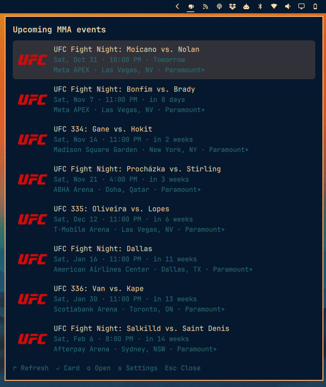

# Omarchy MMA

Upcoming MMA events in the Omarchy bar. Click the glove to see what's coming up
from the promotions you follow, then click an event for its full fight card:
main card first, prelims after, with the challenger always on the right.



## Requirements

- Omarchy with the Quickshell-based shell (`omarchy-shell`)
- `curl` and `bash`
- A Nerd Font in the bar (the glyph is `nf-md-boxing_glove`, U+F0B65)
- For the tests only: `node`

## Install

```sh
git clone https://github.com/anavarre/omarchy-mma ~/.config/omarchy/plugins/anavarre.mma
omarchy plugin validate ~/.config/omarchy/plugins/anavarre.mma
omarchy plugin enable anavarre.mma
omarchy-shell shell rescanPlugins
```

## Uninstall

```sh
omarchy plugin disable anavarre.mma
omarchy plugin remove anavarre.mma
omarchy-shell shell rescanPlugins
rm -rf ~/.cache/omarchy-mma
```

If you installed by hand, delete `~/.config/omarchy/plugins/anavarre.mma` instead of
running `omarchy plugin remove`. Also remove any leftover `anavarre.mma` entry from
`~/.config/omarchy/shell.json`.

## Settings

Open the widget's settings in the Omarchy shell (or edit its entry in
`~/.config/omarchy/shell.json`):

| Setting | Default | |
|---|---|---|
| `organizations` | `["ufc"]` | Promotions to follow. UFC and PFL are supported. |
| `eventLimit` | `10` | Events in the list, 1 to 30. |
| `lookaheadDays` | `120` | How far ahead to look. |
| `refreshMinutes` | `180` | Background refresh interval. |
| `timeFormat` | `12h` | `12h` or `24h`. |
| `timeZone` | `venue` | Time zone for event times: `venue` (each event's own location, worked out from its venue address) or `local` (this computer's). Also set from the panel's settings, above the text size. |
| `textSize` | `medium` | `small`, `medium`, `large` or `xlarge`. |

## Using it

- Click the glove: the event list, each event with its promotion's logo. Middle-click: refresh.
- `s` opens the settings view: tick the organizations to follow (UFC on, PFL off by default).
  Space or Enter toggles, `Esc` goes back. The choice is saved to `shell.json`.
- `↑`/`↓` move, `Enter` (or click) opens the card, `o` opens the event in your browser,
  `r` refreshes, `Esc` goes back, then closes.
- On a card, `↑`/`↓` scroll and `←` goes back.

Logos are ESPN's league logos for UFC and PFL, bundled in `assets/`; they remain the
property of their owners.

## Where the data comes from

ESPN's public JSON API. It needs no key, but it is unofficial and could change.

- `site.api.espn.com/.../mma/<league>/scoreboard` lists upcoming events, their
  fights and fighters.
- `sports.core.api.espn.com/.../competitions/<id>` says which segment each
  fight is on (`main`, `prelims1`, `prelims2`) and its billing. It is fetched
  when an event is opened. If it fails, the card is split by fight start times.
- Fighter `order` 1 is the champion or higher-billed fighter and 2 is the
  challenger. ESPN lists them in no fixed order, so the plugin sorts by it.

Only UFC and PFL are supported. Another promotion would need a second provider
beside `bin/mma-api`.

Events are cached in `~/.cache/omarchy-mma/events.json` and shown when the source
can't be reached.

## Tests

```sh
tests/run
```

Runs `Model.js` against saved ESPN responses in `tests/fixtures/` and checks
`bin/mma-api`'s argument handling. No network or display needed.

## License

MIT. See [LICENSE.md](LICENSE.md).
